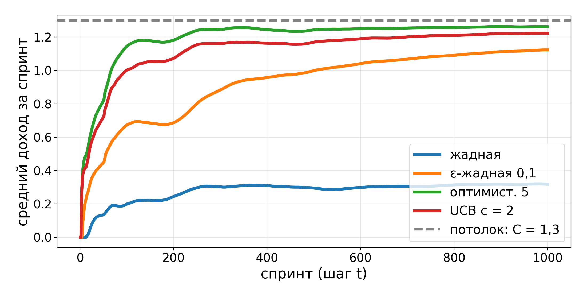
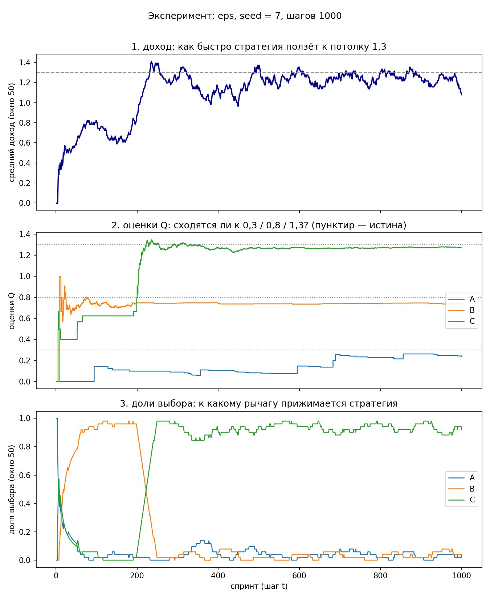

# Задание и отчёт: многорукий бандит

ФИО, группа, дата — Губайдулина Юлия Юрьевна, М8О-202СВ-25, 27.10.26.

В `agent.py` два пустых места, остальное готово. Задания идут по порядку: первые два про код, дальше
прогоны и отчёт. Где освежить теорию — ссылки в шапке `agent.py` («Как двигается оценка» на семинаре 3
и «ε-жадная стратегия» в теме 2).

---

## Задание 1. Правило обновления оценки

`update()` в `agent.py`. Шаг строкой выше уже посчитан: `1/n` по этому рычагу или `α`, если он задан.
Впишите одну строку — сдвиг оценки на шаг, умноженный на разницу:

```python
self.q[act] += step * (reward - self.q[act])
```

Первое наблюдение по рычагу оценку не подтягивает, а задаёт — эта строка в коде уже есть, её не трогайте.

**Что сделать.** Запустить `python3 agent.py`: все строки `[ok]`, ряд по рычагу B идёт `1 → 0,5 → 1,0`
при `1/n` и по-другому при `α`.

**Ответ:** 
```
Агент: тимлид и пять стратегий выбора подхода
   greedy · eps · optimistic · ucb · gradient

Истинные средние среды (агенту не видны): A = 0,3 · B = 0,8 · C = 1,3

Ряд по подходу B: наблюдения 1, 0, 2
   шаг  награда    n   Q при 1/n   Q при α = 0.50
    1         1    1       1.000          1.000
    2         0    2       0.500          0.500
    3         2    3       1.000          1.250
   при 1/n оценка равна честному среднему; при α — тянется к свежему

Проверки агента:
   [ok] агент: инкрементальное среднее по B: 1 → 0,5 → 1,0 (честное среднее 1,0)
   [ok] агент: тот же ряд при α = 0,5: 1 → 0,5 → 1,25
   [ok] агент: жадный выбор по оценкам 0,5 / 1,2 / 0,9 — B
   [ok] агент: ucb на старте тянет нетронутый рычаг
   [ok] агент: ucb берёт не самую частую, а самую неуверенную: C (n = 1)

итог: все проверки агента сошлись
```


---

## Задание 2. ε-жадный выбор

`act()` в `agent.py`. С вероятностью `epsilon` — любая рука наугад, иначе — лучшая по текущим оценкам:

```python
if self.rng.random() < self.epsilon:
    return self.rng.choice(APPROACHES)
return self.greedy_choice()
```

**Что сделать.** Запустить `python3 run.py`: таблица стратегий должна сойтись с той, что была на
занятии. Если разошлась — смотрите строки с `[нет]`, там сказано, какое место пустое или какое число
не сошлось.

**Ответ:**
```
   [ok] прогон: среда: распределения и средние сошлись
   [ok] прогон: агент: оценки и стратегии сошлись
   [ok] прогон: UCB находит C и держит её: доля выбора C = 93%
   [ok] прогон: жадная проигрывает ε-жадной: 0.31 против 1.12
   [ok] прогон: ε-жадная не обгоняет UCB: 1.12 против 1.22

1000 спринтов тимлида (seed = 7):
   стратегия         средний       доля C
   оптимист. 5         1.257         100%
   градиентная         1.242          94%
   UCB c = 2           1.218          93%
   ε-жадная 0,1        1.120          76%
   жадная              0.310           0%

потолок — всегда тянуть C: средняя 1,3 (истинная средняя лучшего подхода)

итог: все проверки прогона сошлись
```


---

## Задание 3. Пять стратегий — свои числа

Прогнать пять команд, по одной на стратегию. Числа из этой таблицы понадобятся на следующем занятии,
начнём с них.

* `python3 run.py --exp --strategy greedy`
* `python3 run.py --exp --strategy eps`
* `python3 run.py --exp --strategy optimistic`
* `python3 run.py --exp --strategy ucb`
* `python3 run.py --exp --strategy gradient`

**Ответ:** доход за спринт и доля выборов руки C.

| стратегия | средний доход | доля C |
|---|---|---|
| жадная | 0.310 | 0% |
| ε-жадная, ε = 0,1 | 1.120 | 76% |
| оптимистичная, Q₀ = 5 | 1.257 | 100% |
| UCB, c = 2 | 1.218 | 93% |
| градиентная | 1.242 | 94% |


---

## Задание 4. Ручки в `run.py`

В `run.py` есть настройки, которые вы выбирали сами. По каждой — что поставили и почему именно так.

**Что сделать.** Открыть `run.py`, выписать свои значения.

**Ответ:**

| что вписал | значение | почему такое |
|---|---|---|
| `PROBS` (A / B / C) | (0.8, 0.1, 0.1) / (0.3, 0.6, 0.1) / (0.1, 0.5, 0.4) | Вероятности для трех подходов, дающие средний доход 0,3 / 0,8 / 1,3, чтобы потом выявить находят ли стратегии лучший вариант  |
| `STEPS` | 1000 | Достаточно для того, чтобы стратегии сошлись |
| `SEED` | 7 | Для воспроизводимости |
| `epsilon` | 0.1 | 10% шагов на исследование (случайный выбор), остальное - на вариант с самой высокой оценкой |
| `q0` | 5.0 | Завышенная начальная оценка, чтобы агент сначала попробовал все варианты, и потом через усреднение весов добрался к истине |
| `c` | 2.0 | Определяет, насколько сильно UCB учитывает недостаток информации о варианте. 2 - баланс случайного и лучшего выбора. Если больше - упадет доход. Если меньше - риск застрять |
| `h_alpha` | 0.1 | Определяет скорость изменения предпочтений в градиентной стратегии. Слишком большой шаг - вероятности скачут, слишком маленький - не успевает выучить |
| `update()` — формула | self.q[act] += step * (reward - self.q[act]), где step = α или 1/n | Инкрементальное среднее: обновляет оценку после каждой награды. При step = 1/n получается обычное среднее всех наблюдений, а при постоянном α оценка сильнее реагирует на последние результаты |

---

## Задание 5. График 1 — доход по стратегиям

**Что сделать.** `python3 run.py --png`. Рядом с `run.py` появится `bandit-1000.png`. Вставить картинку
и написать 2–3 предложения с числами: кто застрял и на чём, кто подошёл к потолку 1,3, насколько
отстаёт жадная.

**Ответ:**

```
   [ok] прогон: среда: распределения и средние сошлись
   [ok] прогон: агент: оценки и стратегии сошлись
   [ok] прогон: UCB находит C и держит её: доля выбора C = 93%
   [ok] прогон: жадная проигрывает ε-жадной: 0.31 против 1.12
   [ok] прогон: ε-жадная не обгоняет UCB: 1.12 против 1.22

1000 спринтов тимлида (seed = 7):
   стратегия         средний       доля C
   оптимист. 5         1.257         100%
   градиентная         1.242          94%
   UCB c = 2           1.218          93%
   ε-жадная 0,1        1.120          76%
   жадная              0.310           0%

потолок — всегда тянуть C: средняя 1,3 (истинная средняя лучшего подхода)

картинка: C:\Users\user\Documents\RL_labs\seminar_03\bandit-1000.png

итог: все проверки прогона сошлись
```
На графике виден средний доход пяти стратегий за 1000 спринтов. Пунктирная линия на уровне 1,3 - максимальный средний доход, который можно получить, если всегда выбирать подход C.  

Жадная стратегия застряла на A и получила средний доход 0.310, потому что не исследует другие варианты. ε-жадная показала результат 1.120, так как иногда продолжает случайно выбирать менее выгодные подходы. Лучше всего сработала оптимистичная стратегия - 1.257 (ближе всего к максимуму 1.3, который пунктиром). Градиентная стратегия получила 1.242, а UCB - 1.218. Обе тоже достаточно близко подошли к максимуму.


---

## Задание 6. График 2 — как шло обучение

**Что сделать.** `python3 run.py --exp` — по умолчанию ε-жадная; другая стратегия — `--exp --strategy UCB`
(имя из `STRATEGIES`). Файл `experiment.png`, три панели. Если matplotlib не встал, `--exp` печатает ту
же картину таблицей по сотням спринтов — для ответа хватает и её.

Ответить на три вопроса: сошлись ли оценки Q к 0,3 / 0,8 / 1,3, к какому рычагу прижались доли выбора
и где оценка «убежала» — и почему именно там.

**Ответ:**


На графике показано, как ε-жадная стратегия обучалась в течение 1000 спринтов. А именно: изменение среднего дохода, оценки Q для каждого подхода, как часто агент выбирает каждый из трех вариантов. Используется скользящее окно в 50 шагов. Скачки оценок в начале обучения из-за того, что первые случайные награды сильно влияют на результат, пока наблюдений еще мало.  

1) **Сошлись ли оценки Q к 0.3 / 0.8 / 1.3?**  
Полностью не сошлись. К концу эксперимента оценки составили примерно: 0.24 / 0.74 / 1.27. Оценка C выбиралась чаще остальных и оказалась ближе всего к истинному значению. Для A и B наблюдений было меньше поэтому оценки менее точны.  
  
2) **К какому рычагу прижались доли выбора?**  
Примерно после 250 шага агент стал чаще выбирать C. A и B выбираются гораздо реже, но полностью не исчезают из-за случайных выборов с вероятностью ε = 0,1.  

3) **Где оценка «убежала» — и почему именно там?**    
Сильнее всего от истинного значения отклонилась оценка A. Потому что после того, как агент нашел более выгодный вариант C, он стал редко возвращаться к A.  

---

## Задание 7. Три вывода

Каждый — число плюс объяснение, почему так. Вывод без числа не считается, число без объяснения тоже.
Три штуки — потому что первые два обычно очевидные, а третий и есть ваш.

Если не знаете, с чего начать, вот что на этом занятии вылезало у всех:

* как ведёт себя ε: 0,01 — разведки не хватает, 0,5 — платите слишком много, 0,1 между ними;
* почему жадная при `q0 = 0` застревает на первом по алфавиту рычаге при любом seed;
* зачем оптимистичной и UCB случайные шаги, если они и так обходятся без них;
* что делают с оценками Q шаги 0,9 и 0,01 — и где тут нестационарность.

**Ответ:**
1. **ε = 0.1 - разумный компромисс.**  
При ε = 0.01 средний доход составил 1.071, при ε = 0.1 - 1.120, при ε = 0.5 - 0.988. При маленьком ε агент редко пробует другие варианты, при большом - слишком часто отвлекается от самого выгодного. ε = 0.1 дает лучший результат, так как позволяет совмещать исследование и выбор уже найденного хорошего варианта.
2. **Жадная стратегия может застрять на первом варианте, если не исследует остальные.**  
При `q0 = 0` жадная стратегия во всех 1000 спринтах выбирала A. Ее средний доход составил 0.310 вместо 1.3, т.к. она просто по алфавиту выбирала А, даже не проверяя приносят ли B и C больше дохода.  
3. **Размер α влияет на то, насколько быстро меняются оценки Q.**  
При α = 0.9 оценка быстро реагирует на новые награды, поэтому может сильно колебаться и зависеть от последних результатов. При α = 0.01 обновление происходит медленнее и более плавно. При постоянном α старые наблюдения постепенно теряют влияние, поэтому такой способ обновления полезен, если условия со временем меняются. Если же среда не меняется, обычное среднее с шагом 1/n позволит постепенно получать более точную оценку.
---

## Задание 8. Что не получилось

Где числа разошлись с эталоном, что сломали и как чинили, что так и не поняли. За это не снижаем —
наоборот, по этим абзацам видно, что вы реально запускали.

**Ответ:**
Больше всего вопросов возникало с настройкой стратегий.  
* С ε-жадной сначала не сходились доли выбора. EXP_EPSILON в experiment() и epsilon в STRATEGIES должны совпадать по значениям, чтобы графики не разошлись.  
* В update() сначала вписала замену вместо сдвига. Первый вариант был `self.q[act] = reward` - оценка прыгала к последнему наблюдению, потом исправила на `step × (reward − Q)` - ряд сошелся.  

Осталось не до конца понятным, почему оптимист в итоге обгоняет UCB (1.257 против 1.218). 